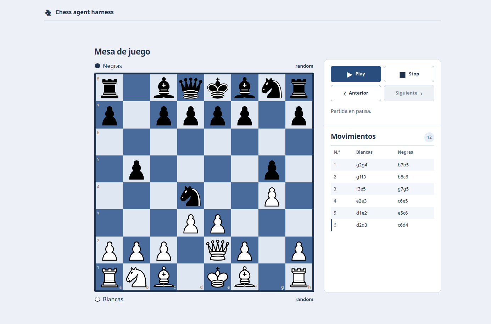

# chess-agent-harness

**A framework designed to help any LLM play chess as well as it can—without cheating.**

This is not a chess bot or another model-strength benchmark. It is an
architecture layer between an LLM and the rules of chess: the model makes the
decisions while a deterministic environment owns the state, exposes the
available moves, and validates every action.

The MVP already lets users watch and control a complete game from a live web
interface. The project will evolve in phases to investigate which agent
architectures actually help an LLM play better, without turning a chess engine
into an oracle.



## What is this?

`chess-agent-harness` is an agent environment in which an LLM plays complete
chess games through a structured contract. The position lives in `ChessEnv`,
`python-chess` is the authority on the rules, and every agent returns a UCI move
such as `e2e4`.

The LLM agent supports two modes:

- `tools` exposes `legal_moves` and `make_move` through tool calling. The current
  position is included in the observation, and `make_move` restricts the choice
  to the legal moves known by the environment.
- `plain` includes the FEN and legal move list in the prompt and requests one UCI
  move. This mode supports OpenAI-compatible servers without tool calling.

In both modes, the environment validates the action again. If the LLM proposes
an illegal move and fallback is enabled, the harness emits a visible event and
continues the game with a random legal move.

| Other projects | `chess-agent-harness` |
|---|---|
| Measure and rank models | Improves the architecture available to any LLM |
| Ask which model wins | Asks which context and tools help the model |
| May let an engine choose the move | The LLM decides; the environment verifies |
| Focus on aggregate results | Focuses on the agent decision loop |

## What works today

The current MVP includes:

- `random vs random`, `LLM vs random`, and `LLM vs LLM` games;
- an OpenAI-compatible client for OpenAI, Ollama, vLLM, and LM Studio;
- move selection through tool calling or plain-text UCI responses;
- move legality and game-over validation with `python-chess`;
- configurable fallback for illegal LLM moves;
- a configurable maximum number of plies;
- live FastAPI and WebSocket events;
- a React board with move history, Play/Pause, Stop, Previous, and Next;
- one shared game for all connected spectators;
- in-memory state and event replay for the running process;
- optional PGN deliberately kept outside the required MVP flow.

## What this is not

- **It is not a chess engine.** It does not try to compete with Stockfish.
- **It is not a benchmark yet.** There is no leaderboard, model ranking, or
  aggregate metrics layer.
- **It does not use an engine as an oracle.** Validation checks rules and
  legality; it does not recommend the best move.
- **It does not retain memory between games.** Every game starts clean.
- **It has no authentication or rooms.** Every connected client watches and
  controls the same game.
- **It does not persist a per-ply trace.** History stays in memory for event
  replay and frontend navigation.
- **It is not a finished product.** It is a usable core for controlled
  experiments.

## What is it useful for?

1. **Agent development.** Observe how an LLM behaves in a formal domain with
   verifiable rules, explicit state, and a long decision horizon.
2. **Controlled experiments.** Compare prompts, tool contracts, memory, or
   verification strategies without rewriting the rules or agent interface.
3. **Live demonstrations.** Watch a game in real time, pause or reset it, and
   navigate through the positions received by the browser.
4. **A future evaluation bed.** Add reproducibility and measurement once the
   core is stable, while keeping execution separate from evaluation.

## Design principles

1. **State lives in the environment.** The model receives an observation; it is
   never the source of truth for the board.
2. **Tools first.** When the provider supports them, the agent chooses moves
   through tools with structured arguments.
3. **The LLM decides.** No chess engine selects a move on behalf of the model.
4. **Deterministic verification.** `python-chess` resolves legality, turns, and
   game-ending conditions.
5. **Separation of concerns.** The loop emits events without knowing about
   WebSocket or React, and the transport layer contains no agent logic.
6. **Phased extension.** Memory, metrics, and evaluation should integrate around
   the existing contracts rather than replace the core.

## MVP architecture

```text
React frontend
    │  commands: start / pause / resume / stop
    │  events: game_started / move / illegal / control / game_over / game_reset
    ▼
FastAPI WebSocket ── ConnectionManager
    │
    ▼
game_loop ── Agent.act(Observation) → Action
    │                 ├── RandomAgent
    │                 └── LLMAgent (plain | tools)
    ▼
ChessEnv ── python-chess
```

```text
backend/
├── main.py              FastAPI app and shared-game controls
├── core/
│   ├── env.py           state and rules powered by python-chess
│   ├── schemas.py       Observation and Action contracts
│   └── game_loop.py     transport-independent event loop
├── agents/
│   ├── base.py          common agent interface
│   ├── random_agent.py  reference agent
│   └── llm_agent.py     OpenAI-compatible client
└── ws/
    └── manager.py       connections, broadcast, and in-memory replay

frontend/src/
├── App.tsx              spectator state and controls
└── components/Board.tsx read-only chessboard

configs/game.yaml        agents and game limits
```

`game_loop` does not import `ws` or frontend code. `ConnectionManager` does not
import agents. `main.py` is the composition root: it constructs agents, connects
the loop to the transport, and handles user commands.

## Game controls

- **Play** starts a new game or resumes a paused game.
- **Pause** stops the loop before the next decision. An LLM request that is
  already running may finish first.
- **Stop** cancels the task, clears the move history, and restores the initial
  position.
- **Previous** and **Next** navigate locally through received positions without
  changing the shared backend state.

When a browser reconnects, the server replays the events held in memory.
Restarting the backend process clears that state.

## Installation

Requirements: Python 3.11 or later and pnpm.

```sh
python3 -m venv .venv
source .venv/bin/activate
pip install -e '.[test]'
pnpm --dir frontend install
```

Start the backend:

```sh
source .venv/bin/activate
uvicorn backend.main:app --reload --host 0.0.0.0 --port 8000
```

In another terminal, start the frontend:

```sh
pnpm --dir frontend dev
```

Open [http://localhost:5173](http://localhost:5173).

## Agent configuration

The project defaults to `random vs random`, so it works without credentials.
Configuration lives in `configs/game.yaml`:

```yaml
white:
  type: llm
  provider: openai
  base_url: https://api.openai.com/v1
  model: gpt-4o-mini
  mode: tools

black:
  type: random

max_plies: 200
illegal_fallback: true
move_delay: 0.4
ws:
  host: 0.0.0.0
  port: 8000
```

For OpenAI, export the API key before starting the backend:

```sh
export OPENAI_API_KEY='your-key'
```

For Ollama, vLLM, or LM Studio, use the server's OpenAI-compatible endpoint, set
`provider: local`, and select an installed model. Use `mode: plain` if the server
or model does not support tool calling. YAML changes require a backend restart.

## Verification

```sh
.venv/bin/python -m pytest
.venv/bin/python -m backend.core.game_loop
pnpm --dir frontend build
```

The current tests cover valid FEN positions throughout the loop, recovery from
an illegal move, and the basic WebSocket event flow, including reset.

## Project roadmap

The project will validate each capability before adding the next one.

### Phase 1 — Playable core

Stabilize the observation and action contracts, game loop, user controls, and
OpenAI-compatible providers. This is the current phase.

### Phase 2 — Reproducibility and evaluation

Add game identifiers, seeds, optional persistent PGN, reproducible events, and
metrics outside the game loop. This will allow strategies to be compared without
turning the core into a benchmark runner.

### Phase 3 — Better context for the LLM

Evaluate within-game memory, structured summaries, plans, and retrieval of
similar positions. Every addition should demonstrate a measurable improvement
over the baseline agent.

### Phase 4 — Controlled tactical verification

Explore candidate critics and verification strategies. If Stockfish is added,
its role will be an opponent, post-game evaluator, or explicit experimental
component—never a hidden channel that gives the LLM the correct move.

### Phase 5 — Scale

Add multiple rooms, game isolation, authentication, workers, and an experiment
runner without changing the fundamental `ChessEnv` and `Agent` contracts.

The roadmap is a design direction, not a claim that these features already
exist.

## License

Distributed under the [MIT License](LICENSE).
